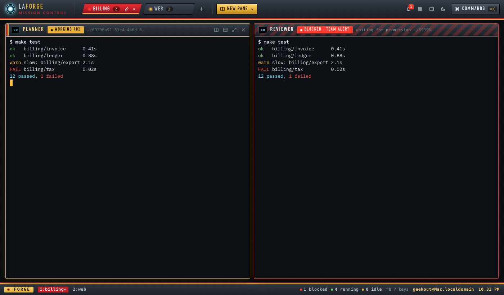

# Mission Control (Avengers): a personal fan skin for LaForge

A skin in the manner of the Avengers' command room, in the classic layout,
dark mode. Brushed-gunmetal plating with a red and gold stripe, an
arc-reactor roundel beside "LaForge / Mission Control", slanted armour-plate
tabs (the active one red with a gold edge), and panes framed as mission
briefings with corner brackets. Blocked panes raise a pulsing red TEAM ALERT
with hazard stripes across the header; done reads Debrief, idle reads
Standing by.

**This is a personal fan skin. It is not for distribution.** The characters,
names and marks it evokes belong to their owners. It ships no official logos,
sprites or artwork: everything is drawn with original CSS. Keep it in a
private repository; do not publish, bundle or ship it with LaForge.

Install it into a forge:

    la skin install ~/projects/laforge/laforge-private-skins/avengers-mission-control
    la skin use avengers-mission-control        # or pick "Skin: Mission Control (Avengers)" in the forge's palette (⌘K)

Fonts: system faces only, nothing bundled and nothing loaded from the network.

