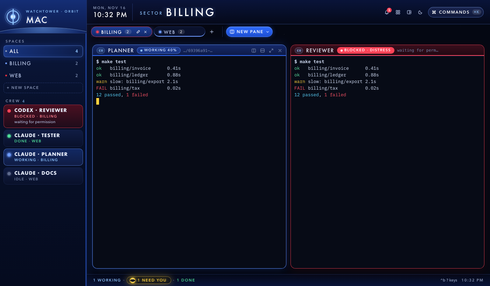

# Watchtower (DC): a personal fan skin for LaForge

A skin in the manner of the Justice League's orbital Watchtower, in the rail
layout, dark mode. A star field with the planet's blue limb glowing up from
below, a Metropolis-blue rail with a slowly turning station emblem
("Watchtower · Orbit"), spaces as station sectors, and the crew as members on
watch. A blocked seat sends out a red distress beacon that pulses outward;
the footer's need-you count becomes a noir yellow signal glowing in the sky.

**This is a personal fan skin. It is not for distribution.** The characters,
names and marks it evokes belong to their owners. It ships no official logos,
sprites or artwork: everything is drawn with original CSS. Keep it in a
private repository; do not publish, bundle or ship it with LaForge.

Install it into a forge:

    la skin install ~/projects/laforge/laforge-private-skins/dc-watchtower
    la skin use dc-watchtower        # or pick "Skin: Watchtower (DC)" in the forge's palette (⌘K)

Fonts: system faces only, nothing bundled and nothing loaded from the network.

