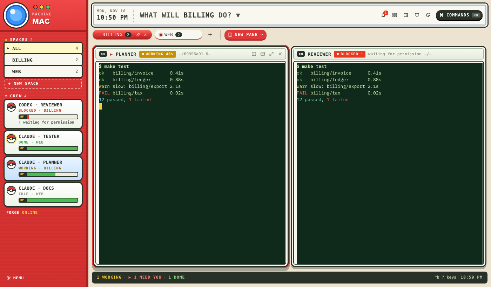

# Trainer HUD (Pokémon): an unofficial fan skin for LaForge

A skin in the manner of a Pokémon trainer's handheld, with the spaces in the rail (or on top),
light mode. The rail is a red handheld with a lens and three status lights.
Spaces are menu entries with a blinking ▶ cursor. The crew is your party:
each seat is a slot card with a red-and-white capsule (it wobbles while
working, glows when done, flashes when blocked) and an HP bar filled by
status (full when idle or done, part-drained while working, nearly empty and
flashing when it needs you). The header asks "What will BILLING do? ▼",
panes are battle text boxes around a Game Boy-green terminal, and the footer
is the trainer card strip.

It draws both light and dark: the forge's light/dark switch picks the mode.

**Unofficial fan work.** It is not affiliated with, endorsed or sponsored by the
rights holders. Pokémon is a trademark of Nintendo, Creatures Inc. and GAME FREAK inc. It ships no official logos, sprites or artwork:
everything is drawn with original CSS and system fonts.

Install it into a forge (after `git clone https://github.com/corcoranp/laforge-fan-skins`):

    la skin install ./laforge-fan-skins/pokemon-trainer
    la skin use pokemon-trainer        # or pick "Skin: Trainer HUD" in the forge's palette (⌘K)

Fonts: system faces only, nothing bundled and nothing loaded from the network.

